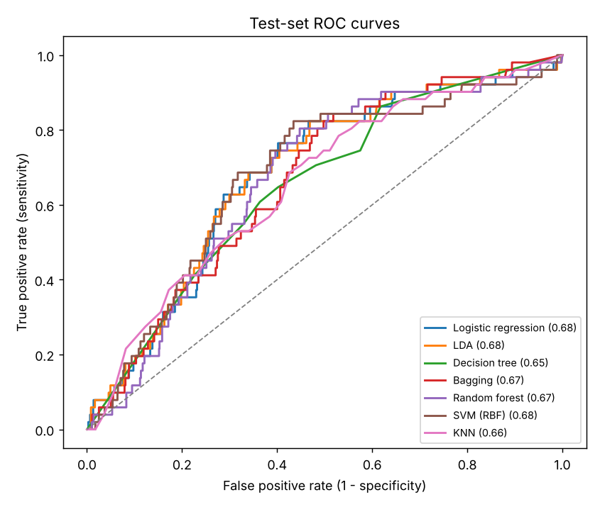

# Predicting breast-cancer metastasis with machine learning

My BSc thesis in Industrial Engineering at the **Iran University of Science and Technology**, supervised by **Dr. Farnaz Barzinpour** (2023). The thesis title is *Prediction of Breast Cancer Metastasis Using Data Mining*.

The task is to predict whether a breast-cancer patient will develop **metastasis or recurrence** during follow-up, using only information available at diagnosis and initial treatment. The data are **3,753 patient records from the Motamed Cancer Institute (Tehran)**: 35 features covering demographics, reproductive history, tumour pathology and treatment. Only **169 patients (4.5%) had an event**, so the classes are heavily imbalanced.

> **Data privacy.** The clinical data are confidential and are **not** included in this repository. The code drops direct identifiers on load, and the repository contains only code and aggregate results.

## Approach

1. **Cleaning** ([`src/prepare.py`](src/prepare.py)) applies clinically motivated, row-wise rules:
   - ER/PR are filled from each other, since they are strongly concordant.
   - Menopausal and reproductive status are inferred from age.
   - Lactation and OCP duration are set to zero when the precondition is absent.
   - Unknown receptor status gets its own level.
   - Surgery is recoded to breast-conserving vs mastectomy.
2. **Modelling** ([`src/train.py`](src/train.py)) uses an `imblearn` pipeline (median/mode imputation → standardisation → **SMOTE-ENN** resampling → classifier). It is tuned with 5-fold stratified CV on ROC AUC and evaluated once on a stratified 30% hold-out test set.
3. **Seven classifiers:** logistic regression, LDA, decision tree, bagging, random forest, SVM and KNN.

## Results (hold-out test set, 1,126 patients, 51 events)

| Model | Test AUC (95% CI) | Sensitivity | Specificity |
|---|---|---|---|
| **LDA** | **0.685** (0.61–0.75) | 0.75 | 0.59 |
| **Logistic regression** | **0.681** (0.61–0.75) | 0.76 | 0.59 |
| SVM (RBF) | 0.681 (0.60–0.75) | 0.69 | 0.63 |
| Random forest | 0.669 (0.60–0.74) | 0.29 | 0.83 |
| Bagging | 0.666 (0.60–0.73) | 0.31 | 0.82 |
| KNN | 0.658 (0.58–0.73) | 0.82 | 0.41 |
| Decision tree | 0.652 (0.58–0.72) | 0.61 | 0.64 |

Sensitivity and specificity use a 0.5 threshold on the predicted probability. Confidence intervals come from 2,000 bootstrap resamples of the test set. Full numbers are in [`results/model_comparison.csv`](results/model_comparison.csv).



**Takeaways**

- As in the thesis, the **linear models (logistic regression and LDA) perform best**. Flexible ensembles add nothing here.
- With an event rate of 4.5% and only 51 test events, the AUC intervals overlap heavily. The models are clearly better than chance but similar to each other.
- At a 0.5 threshold, the tree ensembles trade sensitivity for specificity. For screening, where a missed metastasis costs more, the linear models' operating point is the more useful one.

## What changed from the original thesis analysis

This repository is a cleaned-up rewrite of the original Colab notebooks. Three changes remove sources of optimism in the original pipeline:

| | Thesis (2023) | This repository |
|---|---|---|
| Imputation, scaling | Fitted on the full dataset before the split | Fitted on training folds only, inside the pipeline |
| Outlier removal | Isolation forest on the full dataset | Not used; rows are kept |
| Split | Random | Stratified on the outcome |
| Best test AUC | 0.75 (LR, LDA) | 0.69 (LDA, LR) |

The ranking of the models is the same. The lower AUC is the more honest estimate of performance on new patients.

## Reproduce (with authorised data access)

```bash
pip install -r requirements.txt
python src/train.py --data /path/to/BreastCancerData.sav
```

It takes about two minutes on a laptop and writes `results/` and `figures/`.
